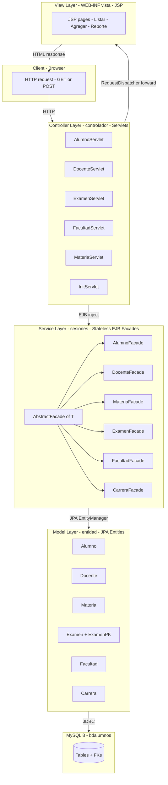
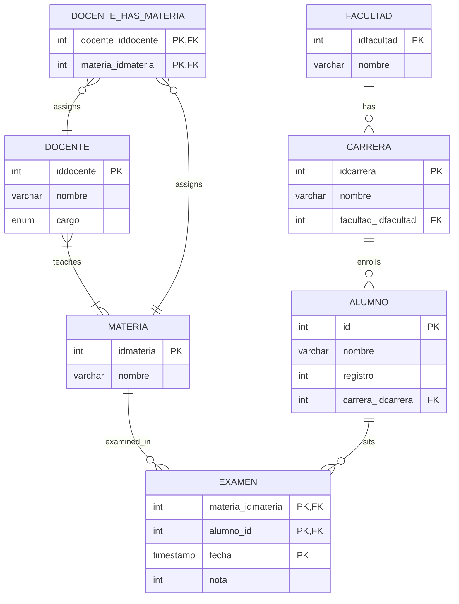
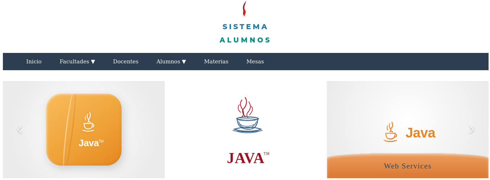

# Alumnos — University Enrollment & Exam Management System

-orange)      

> Jakarta EE 11 web application for managing **faculties, careers, students, teachers, subjects and exam records** in a university faculty. Deployed as a WAR on GlassFish 8, using a classic **Servlet + JSP + Stateless EJB Facade** MVC architecture over MySQL 8 through the `jdbc/bdalumnos` JTA data source. Built and maintained inside Apache NetBeans 31.

---

## Table of Contents

1. [Overview](#overview)
2. [Technology Stack](#technology-stack)
3. [Project Structure](#project-structure)
4. [Architecture (MVC)](#architecture-mvc)
5. [Data Model](#data-model)
6. [Prerequisites](#prerequisites)
7. [Installation](#installation)
8. [Generating Entities & Facades with NetBeans Wizards](#generating-entities--facades-with-netbeans-wizards)
9. [Configuration Notes](#configuration-notes)
10. [Usage Guide](#usage-guide)
11. [Servlet Routing Reference](#servlet-routing-reference)

---

## Overview

**Alumnos** is a Jakarta EE 11 web application developed in Apache NetBeans 31 that manages the academic records of a university faculty. It allows operators to register **faculties**, **careers**, **students**, **teachers**, **subjects** and **exam results**, and to generate the *“Alumnos sin rendir”* report — the list of students enrolled in a career who have not yet sat for a given subject.

The application is deployed as a WAR on **GlassFish Server 8.0.0** and uses a JTA data source (`jdbc/bdalumnos`) backed by a **MySQL 8.4.11** database. The architecture follows the classic MVC pattern: JSP pages act as the **view**, Servlets as the **controller**, and stateless EJB facades (`AbstractFacade` and its six subclasses) encapsulate persistence through JPA over the `AppAlumnos` persistence unit.

## Technology Stack

| Component          | Version / Value                              | Notes                                                            |
|--------------------|----------------------------------------------|------------------------------------------------------------------|
| JDK                | OpenJDK 21.0.12.1 (Debian build)             | Runtime; source/target = **17** in `pom.xml`                     |
| Jakarta EE API     | 11.0.0-M1                                    | `provided` scope by GlassFish                                    |
| Build tool         | Apache Maven (maven-war-plugin 3.4.0)        | Output: `target/Alumnos-1.0-SNAPSHOT.war`                        |
| IDE                | Apache NetBeans IDE 31                       | Optional but recommended for editing                             |
| Application Server | GlassFish Server 8.0.0                        | JTA container, EJB host                                          |
| Database           | MySQL 8.4.11 (Community Server - GPL)        | Schema: `bdalumnos` (utf8mb4 / `utf8mb4_0900_ai_ci`)             |
| JDBC driver        | `mysql-connector-j` 26.7.0                   | Bundled in `WEB-INF/lib`                                          |
| JPA DataSource      | `jdbc/bdalumnos` (JTA)                        | Declared in `persistence.xml`                                    |
| Persistence Unit   | `AppAlumnos` (transaction-type=JTA)          | Injected via `@PersistenceContext(unitName="AppAlumnos")`        |

## Project Structure

```
.
├── nb-configuration.xml           # NetBeans project hints
├── pom.xml                        # Maven build (WAR, Jakarta EE 11)
└── src
    └── main
        ├── java
        │   ├── com/mycompany/alumnos
        │   │   ├── JakartaRestConfiguration.java
        │   │   └── resources/JakartaEE11Resource.java
        │   ├── controlador/                       # ── Controller ── Servlets
        │   │   ├── AlumnoServlet.java
        │   │   ├── DocenteServlet.java
        │   │   ├── ExamenServlet.java
        │   │   ├── FacultadServlet.java
        │   │   ├── InitServlet.java
        │   │   └── MateriaServlet.java
        │   ├── entidad/                          # ── Model ── JPA Entities
        │   │   ├── Alumno.java
        │   │   ├── Carrera.java
        │   │   ├── Docente.java
        │   │   ├── Examen.java
        │   │   ├── ExamenPK.java                  # @Embeddable composite key
        │   │   ├── Facultad.java
        │   │   └── Materia.java
        │   └── sesiones/                          # ── Service ── Stateless EJB Facades
        │       ├── AbstractFacade.java
        │       ├── AlumnoFacade.java
        │       ├── CarreraFacade.java
        │       ├── DocenteFacade.java
        │       ├── ExamenFacade.java
        │       ├── FacultadFacade.java
        │       └── MateriaFacade.java
        ├── resources/META-INF/persistence.xml     # AppAlumnos PU → jdbc/bdalumnos
        └── webapp
            ├── index.jsp                          # Home page
            ├── newfile.md
            ├── Web-App/                           # Static assets
            │   ├── css/{base,components,layout}.css
            │   ├── css/pages/{alumno,carreras,docente,index,materias,mesas,reporte}.css
            │   ├── img/
            │   └── js/
            └── WEB-INF/
                ├── beans.xml                      # CDI enablement
                ├── glassfish-web.xml               # Class-loader + keepgenerated
                ├── web.xml                        # Servlet mappings
                ├── src/style.css
                └── vista/                         # ── View ── JSP pages
                    ├── AgregarAlumno.jsp
                    ├── AgregarDocente.jsp
                    ├── ListarAlumnos.jsp
                    ├── ListarCarreras.jsp
                    ├── ListarDocentes.jsp
                    ├── ListarMaterias.jsp
                    ├── ListarMesas.jsp
                    ├── ReporteAlumnosSinRendir.jsp
                    └── componentes/{header,footer}.jsp
```

## Architecture (MVC)

The application follows the classic **Servlet + JSP + EJB Facade** pattern, layered as **Model → Service → Controller → View**:



**Layer responsibilities:**

- **Model (`entidad`)** — JPA-managed entities mapped to MySQL tables. `Examen` uses an `@Embeddable` composite primary key (`ExamenPK`) formed by `(materia_idmateria, alumno_id, fecha)` — meaning a student cannot sit for the same subject twice at the exact same microsecond.
- **Service (`sesiones`)** — Stateless EJB facades extending `AbstractFacade<T>`. Each one exposes `find`, `findAll`, `create`, `edit`, `remove`, `count` and `findRange` operations, with the container (GlassFish) managing the JTA transactions and the `EntityManager` lifecycle.
- **Controller (`controlador`)** — Servlets receive HTTP requests, invoke the appropriate facade, attach results as request attributes, and `RequestDispatcher.forward` to a JSP view under `/WEB-INF/vista`. `InitServlet` bootstraps reference data (facultades, materias, docentes) on first load.
- **View (`WEB-INF/vista`)** — JSP pages are placed under `/WEB-INF` so they cannot be addressed directly; they must be reached through a Servlet. Shared chrome (header/footer) lives in `componentes/`. Static CSS/JS/images live under `/Web-App`.

## Data Model

The `bdalumnos` database consists of **7 tables**: three reference tables (`facultad`, `carrera`, `materia`), two actor tables (`alumno`, `docente`), one many-to-many association table (`docente_has_materia`), and one transactional fact table (`examen`).



### Tables

| Table                  | PK                                                  | Foreign Keys                                            | Purpose                                                |
|------------------------|-----------------------------------------------------|---------------------------------------------------------|--------------------------------------------------------|
| `facultad`             | `idfacultad`                                         | —                                                       | Reference list of faculties                            |
| `carrera`              | `idcarrera`                                          | `facultad_idfacultad` → `facultad(idfacultad)`           | Career programs offered by each faculty                |
| `materia`              | `idmateria`                                          | —                                                       | Catalog of subjects                                    |
| `docente`              | `iddocente`                                          | —                                                       | Teachers, `cargo` ∈ {`TITULAR`,`ADJUNTO`,`JTP`}        |
| `docente_has_materia`  | (`docente_iddocente`, `materia_idmateria`)           | both FKs                                                | N–M association between teachers and subjects          |
| `alumno`               | `id`                                                 | `carrera_idcarrera` → `carrera(idcarrera)`                | Students enrolled in a career                          |
| `examen`               | (`materia_idmateria`, `alumno_id`, `fecha`)          | `materia_idmateria` → `materia`, `alumno_id` → `alumno`  | Exam record: subject + student + timestamp + grade     |


## Prerequisites

Verify the following tools are installed and reachable on your `PATH` before continuing:

| Tool                  | Required version                          | Check command              |
|-----------------------|-------------------------------------------|----------------------------|
| JDK                   | OpenJDK 21 (17+ works at compile time)    | `java -version`            |
| Maven                 | 3.8+                                      | `mvn -version`             |
| MySQL                 | 8.4.11 (any MySQL 8.x is compatible)      | `mysql --version`          |
| GlassFish             | 8.0.0                                     | `asadmin version`          |
| NetBeans (optional)   | 31                                        | Help ▶ About               |

The MySQL JDBC driver (`mysql-connector-j` 26.7.0) is already declared in `pom.xml` and bundled into `WEB-INF/lib` by the WAR build, so no manual copy to GlassFish's `domain1/lib` is required.

## Installation

### Step 1 — Create the MySQL database

```bash
mysql -u root -p -e \
  "CREATE DATABASE IF NOT EXISTS bdalumnos DEFAULT CHARACTER SET utf8mb4 COLLATE utf8mb4_0900_ai_ci;"
```

The `utf8mb4` charset and `utf8mb4_0900_ai_ci` collation must match the dump shipped in `alumnosDB.sql`, otherwise the restore will fail on accentuated Spanish course names such as *Matemática* and *Inglés*.

### Step 2 — Create the tables following the data model description

After creation

```bash
mysql -u root -p bdalumnos -e "SHOW TABLES; SELECT COUNT(*) AS alumnos FROM alumno;"
```

Expected output: 7 tables

### Step 3 — Create the JDBC connection pool and JNDI resource in GlassFish

Start GlassFish if it is not running:

```bash
asadmin start-domain
```

Create a connection pool pointing at `bdalumnos` (replace `__PASSWORD__` with your MySQL root password):

```bash
asadmin create-jdbc-connection-pool \
  --datasourceclassname com.mysql.cj.jdbc.MysqlDataSource \
  --restype javax.sql.DataSource \
  --property "User=root:Password=__PASSWORD__:URL=jdbc:mysql://localhost:3306/bdalumnos" \
  bdalumnosPool
```

Test the pool before publishing it:

```bash
asadmin ping-connection-pool bdalumnosPool
```

> If `ping` fails, check that MySQL is reachable, that `root` has access from `localhost`, and that `mysql-connector-j` is on the GlassFish classpath (it should already be, since GlassFish 8 ships the driver).

Expose the pool as the JNDI resource the application expects (`jdbc/bdalumnos`):

```bash
asadmin create-jdbc-resource --connectionpoolid bdalumnosPool jdbc/bdalumnos
```

> ⚠️ The JNDI name **must** be exactly `jdbc/bdalumnos`. This is the `<jta-data-source>` declared in `src/main/resources/META-INF/persistence.xml`. Mismatching this name is the most common deployment failure: the app boots but the first DB call throws `NamingException: Lookup failed`.

### Step 4 — Build the WAR

From the project root (where `pom.xml` lives):

```bash
mvn clean package
```

The deployable artifact is generated at:

```
target/Alumnos.war
```

### Step 5 — Deploy to GlassFish

Either from NetBeans (right-click project ▶ **Run**) or from the CLI:

```bash
asadmin deploy target/Alumnos.war
```

To redeploy after a code change without losing the application context:

```bash
asadmin redeploy --name Alumnos target/Alumnos.war
```

### Step 6 — Open the application

Point your browser to:

```
http://localhost:8080/Alumnos/
```

`InitServlet` will bootstrap any missing reference data on first load and then forward to `index.jsp`, which lists shortcuts to every management screen.

## Generating Entities & Facades with NetBeans Wizards

One of the main reasons this project is developed inside Apache NetBeans 31 is that NetBeans ships **JPA and EJB code generators** that read the database schema and produce the `entidad` and `sesiones` packages for you. The seven JPA entities and the seven stateless facades in this project were created with the two wizards described below — you do **not** have to hand-write them.

### Wizard 1 — *Entity Classes from Database*

This wizard introspects the `bdalumnos` schema and generates one `@Entity` class per selected table, including the `@Embeddable` composite key for `examen`.

1. In the **Projects** window, right-click the `Alumnos` project node ▶ **New** ▶ **Other…**
2. In the **New File** dialog, go to **Persistence** ▶ **Entity Classes from Database** ▶ **Next**.
3. In the **Database Tables** step:
   - **Data Source:** pick `jdbc/bdalumnos` (the JNDI name you created in Step 3). If NetBeans prompts you to register the connection, accept it — it will reuse the GlassFish connection pool.
   - **Available Tables ▶ Selected Tables:** move `alumno`, `carrera`, `docente`, `examen`, `facultad`, `materia` (and `docente_has_materia` if you want a dedicated association entity). The wizard auto-detects `examen` as a composite-key table and will offer to generate an `@Embeddable` `ExamenPK` class.
   - Click **Next**.
4. In the **Entity Classes** step:
   - **Class Names:** keep the table names (default) — `Alumno`, `Carrera`, `Docente`, `Examen`, `ExamenPK`, `Facultad`, `Materia`.
   - **Package:** type `entidad` so the generated classes land in `src/main/java/entidad/`, matching the structure shipped in this project.
   - Tick **Generate Named Query Annotations for Persistent Fields** so each entity gets its `@NamedQuery(name = "Alumno.findAll", …)` boilerplate.
   - Tick **Create Persistence Unit** only if `persistence.xml` is not already present — in this project it already exists (`AppAlumnos`), so **leave it unticked**.
   - Click **Next** ▶ **Finish**.
5. NetBeans will write one `*.java` per table under `entidad/`, with `@Entity`, `@Table(name = "…")`, `@Id`, `@GeneratedValue(strategy = GenerationType.IDENTITY)`, the correct `@ManyToOne` / `@OneToMany` relationships inferred from the foreign keys, and the `@Embeddable ExamenPK` plus the `@EmbeddedId` reference inside `Examen`.

> ⚠️ After the wizard runs, open `persistence.xml` and confirm the `<class>` entries for the new entities are listed **or** that the persistence unit uses `<exclude-unlisted-classes>false</exclude-unlisted-classes>`. Otherwise JPA will not find them at deploy time.

### Wizard 2 — *Session Beans for Entity Classes*

This second wizard reads the entities just generated and produces one `@Stateless` facade per entity, all extending a common `AbstractFacade<T>`.

1. Right-click the `Alumnos` project ▶ **New** ▶ **Other…** ▶ **Enterprise JavaBeans** ▶ **Session Beans for Entity Classes** ▶ **Next**.
2. In the **Selected Entity Classes** step, move `Alumno`, `Carrera`, `Docente`, `Examen`, `Facultad`, `Materia` to the right pane. Click **Next**.
3. In the **Entity Classes** step:
   - **Package:** type `sesiones` so the generated facades land in `src/main/java/sesiones/`.
   - **Create Persistence Unit:** leave unticked (already present).
   - Tick **Use EntityManager** (default) so each facade gets the `@PersistenceContext(unitName = "AppAlumnos") private EntityManager em;` injection and the `AbstractFacade` base class.
   - Click **Finish**.
4. NetBeans writes `AbstractFacade.java`, `AlumnoFacade.java`, `CarreraFacade.java`, `DocenteFacade.java`, `ExamenFacade.java`, `FacultadFacade.java`, `MateriaFacade.java` — each `@Stateless`, each with `find`, `findAll`, `findRange`, `count`, `create`, `edit`, `remove`, all delegating to `em`.

### Why this workflow matters

The two wizards together turn the `bdalumnos` schema into a fully wired JPA + EJB service layer in **under a minute**, with no hand-written JDBC, no `PreparedStatement` boilerplate, no manual `EntityManager.find` calls inside the Servlets. The Servlets in `controlador/` simply `@EJB`-inject the generated facades and call `findAll()` / `create()` / `edit()` / `remove()` — exactly the structure shipped in this repository. When the schema evolves (a new column, a new table), re-running Wizard 1 on the affected tables refreshes the entity class without breaking the facades.

## Configuration Notes

### `src/main/resources/META-INF/persistence.xml`

```xml
<persistence version="3.0"
             xmlns="https://jakarta.ee/xml/ns/persistence">
  <persistence-unit name="AppAlumnos" transaction-type="JTA">
    <jta-data-source>jdbc/bdalumnos</jta-data-source>
  </persistence-unit>
</persistence>
```

- `AppAlumnos` is the unit name referenced by every `@PersistenceContext(unitName = "AppAlumnos")` annotation in the facades.
- `JTA` transaction type means **GlassFish manages the transactions**, not the application — facades never call `em.getTransaction().begin()` / `commit()`.
- The JPA provider is the default one bundled with GlassFish 8 (EclipseLink).

### `src/main/webapp/WEB-INF/glassfish-web.xml`

The shipped descriptor keeps the default class-loader delegation (`delegate=true`) and enables `keepgenerated=true` so the generated JSP servlet sources are retained under `build/web` for debugging.

### `pom.xml` highlights

- Java source/target = **17** (the WAR runs on any JDK 17+ runtime; OpenJDK 21 is what the team uses in production).
- `jakarta.jakartaee-api` 11.0.0-M1 is `provided` by GlassFish 8 at runtime, so it does **not** bloat the WAR.
- `mysql-connector-j` 26.7.0 is **not** `provided` — it is bundled in the WAR's `WEB-INF/lib`, since GlassFish 8 does not ship the MySQL driver in its domain lib by default.

## Usage Guide

Once deployed, the home page (`index.jsp`) lists shortcuts to every management screen. Each screen lives behind a Servlet, never directly addressable as a JSP.

<p align="center">
  
</p>

The home page is a simple carousel of Java-themed banners sitting on top of a deep-blue navigation bar with five sections — **Inicio**, **Facultades**, **Docentes**, **Alumnos**, **Materias** and **Mesas**. Each navigation item maps to one of the servlets documented in the [Servlet Routing Reference](#servlet-routing-reference) section.

### Faculties — `FacultadServlet`

Browse the list of faculties (the seed ships 5: *Ciencias Exactas, Físicas y Naturales*, *Ingeniería*, *Filosofía, Humanidades y Artes*, *Ciencias Sociales*, *Arquitectura, Urbanismo y Diseño*). From `ListarCarreras.jsp` you can drill into the careers offered by each faculty.

### Careers — `ListarCarreras.jsp`

Lists careers with their parent faculty. The seed contains only the `TECNICATURA EN PROGRAMACION WEB` career; new ones can be added via the same JSP form. Every career must reference a parent faculty through the `facultad_idfacultad` foreign key.

### Students — `AlumnoServlet`

- **`ListarAlumnos.jsp`** — paginated table of all students, showing name, registration number (`registro`) and career.
- **`AgregarAlumno.jsp`** — form to register a new student; the `carrera` dropdown is populated from `CarreraFacade.findAll()`. Submission triggers `AlumnoServlet.doPost`, which calls `AlumnoFacade.create` and then forwards back to the list view.

### Teachers — `DocenteServlet`

- **`ListarDocentes.jsp`** — table of teachers with their `cargo` column (`TITULAR`, `ADJUNTO` or `JTP`).
- **`AgregarDocente.jsp`** — form to register a new teacher; `cargo` is a select bound to the MySQL `ENUM('TITULAR','ADJUNTO','JTP')` declared on the `docente` table.

### Subjects — `MateriaServlet`

`ListarMaterias.jsp` lists the 23 subjects currently in the catalog. Each subject row can also expose the teachers assigned to it through the `docente_has_materia` association table (a `Materia` is in a N–M relationship with `Docente`).

### Exams — `ExamenServlet`

`ListarMesas.jsp` is the exam-board view. Each row corresponds to an `examen` record, showing subject, student, timestamp (`fecha`, microsecond precision) and grade (`nota`). New exam records are inserted with the composite key `(materia_idmateria, alumno_id, fecha)` — the JPA layer enforces uniqueness on this triple through `ExamenPK`.

### Reports — `ReporteAlumnosSinRendir.jsp`

Generates the list of students enrolled in a career who have not yet sat for any exam of a given subject. The query is essentially a left anti-join between `alumno` (filtered by `carrera`) and `examen` (filtered by `materia`), executed through `AlumnoFacade` / `ExamenFacade`. Useful for identifying students at risk before the end of a term.

## Servlet Routing Reference

| Servlet           | Default URL pattern      | Primary view(s)                                |
|-------------------|--------------------------|------------------------------------------------|
| `InitServlet`     | `/`                      | `index.jsp`                                    |
| `FacultadServlet` | `/FacultadServlet`       | `ListarCarreras.jsp`                           |
| `AlumnoServlet`   | `/AlumnoServlet`         | `ListarAlumnos.jsp`, `AgregarAlumno.jsp`       |
| `DocenteServlet`  | `/DocenteServlet`        | `ListarDocentes.jsp`, `AgregarDocente.jsp`     |
| `MateriaServlet`  | `/MateriaServlet`        | `ListarMaterias.jsp`                           |
| `ExamenServlet`   | `/ExamenServlet`         | `ListarMesas.jsp`                              |

> The exact URL patterns are declared in `src/main/webapp/WEB-INF/web.xml` and/or through `@WebServlet` annotations on each Servlet class. Open `web.xml` or the corresponding Java class to confirm the actual mapping in your deployment.

---

### Common issues during setup

| Symptom                                           | Likely cause                                                                                      | Fix                                                                                              |
|---------------------------------------------------|---------------------------------------------------------------------------------------------------|--------------------------------------------------------------------------------------------------|
| `NamingException: Lookup failed for 'jdbc/bdalumnos'` | The JNDI resource was not created, or GlassFish was restarted after creation without persistence. | Re-run `asadmin create-jdbc-resource --connectionpoolid bdalumnosPool jdbc/bdalumnos`.          |
| `Ping connection pool failed`                     | Wrong credentials, MySQL down, or driver not on classpath.                                       | Verify `mysql-connector-j` is bundled in the WAR and that MySQL is reachable on `localhost:3306`. |
| `Unknown column 'registro'` / charset errors      | Database created with non-`utf8mb4` charset before import.                                       | `DROP DATABASE bdalumnos;` and recreate with `CHARACTER SET utf8mb4 COLLATE utf8mb4_0900_ai_ci`. |
| JSP pages return 404 when opened directly          | Views are under `/WEB-INF/vista` by design; they cannot be addressed directly.                   | Always go through the corresponding Servlet (e.g. `/AlumnoServlet`) to reach the view.          |
